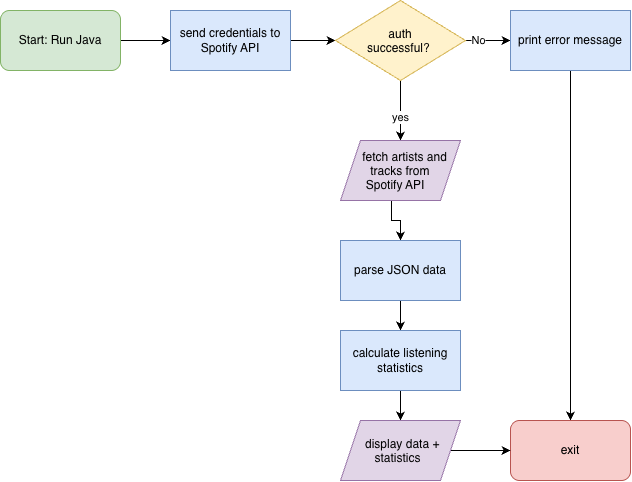

# Project Name

A Java command line application that pulls data form the Spotify API to give user data and calculate statistics.

## The Problem

I spend a lot of time listening to music on Spotify, but the official  app doesn't give me many statistics about my listening besides from Spotify Wrapped. 

## How It Works

The application connects to my Spotify account and pulls from my listening history into the terminal. 
* authenticates with the Spotify API
* fetches top artists, tracks, listening history
* calculates listening statistics



## Tech Stack

- **Language:** Java
- **Libraries:** java.net.http.HttpClient, Gson, dotenv-java
- **External tools:** Spotify Web API

## Setup

To run this project locally, you need Java installed on your machine as well as developer credentials from Spotify Developer. 
```bash
git clone [https://github.com/ryansharma21/spotify-data-analyzer.git](https://github.com/ryansharma21/spotify-data-analyzer.git)
cd spotify-data-analyzer
javac -d bin src/*.java
```

## Usage

java -cp bin Main

## Roadmap

Features you haven't built yet but plan to (pull these from your
"Schedule" quadrant in the Eisenhower Matrix).

- [ ] Export statistics out into a file
- [ ] Generate playlists based on top listening
- [ ] Make graphs in the terminal to see data visually

## Author

Ryan Sharma | https://github.com/ryansharma21
